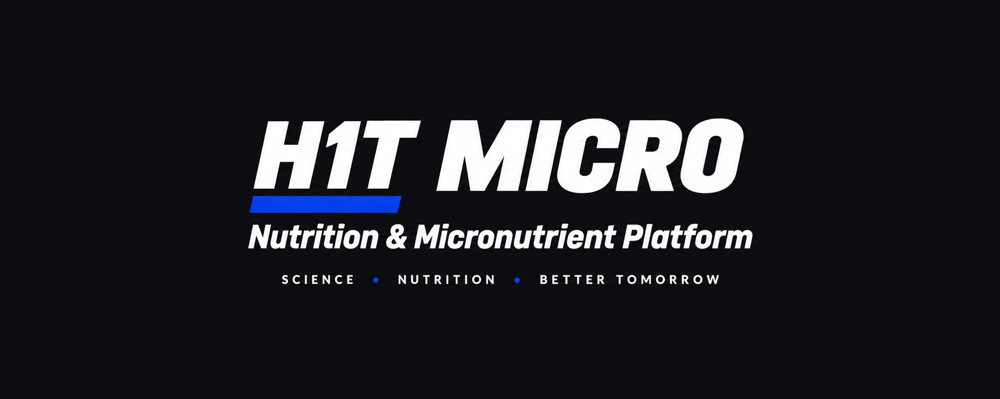

# H1T MICRO

H1T MICRO đồng hành cùng bạn trên hành trình ăn uống khỏe mạnh: hiểu bữa ăn của mình, cân bằng dinh dưỡng và chăm sóc sức khỏe mỗi ngày.

H1T MICRO supports everyday healthy eating: understanding your meals, balancing nutrition and caring for your health, one day at a time.

| Tính năng | Features |
|---|---|
| **Nhật ký ăn uống:** ghi bữa ăn nhanh, theo dõi năng lượng và dinh dưỡng mỗi ngày | **Food diary:** log meals quickly and track energy and nutrients each day |
| **Vi chất:** theo dõi 22 vi chất và xem chất nào còn thiếu | **Micronutrients:** track 22 micronutrients and see which ones you are missing |
| **Tiến độ:** xem xu hướng theo tuần và tháng | **Progress:** see trends by week and month |
| **Thư viện món ăn:** tìm, so sánh và tạo món của riêng bạn | **Food library:** search, compare and create your own foods |
| **Ngày tập:** ghi thời gian luyện tập | **Training:** log your workout minutes |
| **Cộng đồng:** Me Me Mỗi Ngày, bảng xếp hạng và chia sẻ chiến thắng | **Community:** daily memes, leaderboard and win sharing |

Website: [lehongkhanh.vn](https://lehongkhanh.vn)
